# FileSync — Módulo de Sincronização FTP / FTPS
## Documentação Técnica, Funcional e Arquitetura de Interface

> **Versão do Documento:** 1.0.0  
> **Data de Emissão:** 31 de Outubro de 2026  
> **Status:** Especificação e Protótipo Visual Concluídos (15 Telas)  
> **Ambiente Alvo:** .NET 10 / C# 14 / WPF (MVVM) / Windows 10/11 / DPAPI  

---

## 1. Visão Geral e Objetivos do Módulo

O **Módulo FTP / FTPS do FileSync** foi projetado para estender as capacidades nativas de comparação e sincronização local para servidores remotos, com foco absoluto em **segurança operacional**, **isolamento de credenciais**, **integridade de dados** e **prevenção contra exclusões acidentais**.

### 1.1 Princípios Arquiteturais Centrais
1. **Segurança por Padrão (Secure by Default):**
   - Suporte prioritário a **FTPS com TLS 1.3 / 1.2 explícito** e criptografia forte.
   - Proibição de rebaixamento de conexão (*anti-downgrade* para FTP puro em texto simples).
   - Validação de certificados X.509 com suporte a *Certificate Pinning*.
   - Armazenamento de credenciais criptografadas via **Windows Credential Manager / DPAPI**, nunca em arquivos de configuração abertos.

2. **Separação Rígida de Conceitos:**
   - **Ocultar (UI):** Filtro de visualização para focar no que importa sem alterar o plano.
   - **Desmarcar (Checklist):** Exclusão temporária de um item na execução atual, mantendo a regra salva.
   - **Escopo Persistente (Tarefa):** Seleção fixa de pastas/arquivos que define o limite permitido de sincronização.
   - **Excluir Fisicamente:** Operação destrutiva severamente controlada e bloqueada por travas de segurança em perfis produtivos.

3. **Checklist Obrigatório Pré-Transferência:**
   - Nenhuma transferência em servidores de produção ou perfis protegidos ocorre sem a confirmação explícita de um checklist discriminado (operações de envio, atualização, arquivos ignorados e exclusões planejadas).

4. **Preservação de Metadados e ModTime:**
   - Utilização dos comandos RFC 3659 (`MFMT`, `MDTM`) para sincronização e preservação fidedigna das datas de modificação originais dos arquivos locais no servidor remoto.

---

## 2. Mapa Geral das Telas e Fluxo de Navegação

A suíte do protótipo é composta por 15 telas de alta fidelidade armazenadas em `docs/images/ftp/`:

| ID | Tela | Arquivo de Imagem | Propósito Principal |
| :---: | :--- | :--- | :--- |
| **01** | Painel Inicial e Visão Geral FTP/FTPS | `01_Painel_inicial.png` | Dashboard de conexões salvas, tarefas ativas e alertas de produção |
| **02** | Gerenciamento de Conexões Salvas | `02_Gerenciar_conexoes.png` | Listagem e gerenciamento de hosts remotos homologados |
| **03** | Nova Conexão: Configurações Gerais | `03_Nova_conexao_geral.png` | Host, Porta, Protocolo FTPS, Usuário, Senha no Cofre DPAPI e PASV |
| **04** | Nova Conexão: Segurança TLS | `04_Conexao_seguranca.png` | Nível TLS 1.3/1.2, validação de CA, inspeção e Certificate Pinning |
| **05** | Diagnóstico e Teste de Conexão | `05_Teste_conexao.png` | Validação de DNS, TCP, TLS, Certificado, Autenticação, PASV e MFMT |
| **06** | Navegador Remoto e Pastas Iniciais | `06_Navegador_FTP.png` | Árvore de navegação remota no servidor e mapeamento da pasta inicial |
| **07** | Tarefas Salvas e Ações Rápidas | `07_Tarefas_salvas.png` | Painel de tarefas configuradas com execução rápida e histórico |
| **08** | Nova Tarefa: Origem e Destino | `08_Nova_tarefa_geral.png` | Mapeamento explícito de diretório local (origem) e remoto (destino) |
| **09** | Nova Tarefa: Método de Sincronização | `09_Metodo_sincronizacao.png` | Atualizar, Espelhar, Copiar Novos ou Baixar + Travas de Segurança |
| **10** | Nova Tarefa: Escopo Persistente | `10_Selecao_persistente.png` | Seleção permanente de árvore de pastas permitidas na tarefa |
| **11** | Nova Tarefa: Filtros e Exceções | `11_Filtros_excecoes.png` | Regras de inclusão/exclusão (proteção de `.env`, `.git`, `node_modules`) |
| **12** | Comparação FTP/FTPS | `12_Comparacao_FTP.png` | Grid dual de diferenças (novo, atualizado, idêntico, conflitos) |
| **13** | Checklist Obrigatório Pré-Execução | `13_Checklist_obrigatorio.png` | Aprovação formal das operações antes de qualquer escrita remota |
| **14** | Monitoramento de Transferência | `14_Progresso_transferencia.png` | Acompanhamento em tempo real, velocidade MB/s, ETA, fila e log |
| **15** | Histórico e Auditoria | `15_Historico_FTP.png` | Registro forense de execuções, arquivos alterados e exportação CSV |

---

## 3. Especificação Detalhada das Telas

### Tela 01 — Painel Inicial e Visão Geral FTP/FTPS
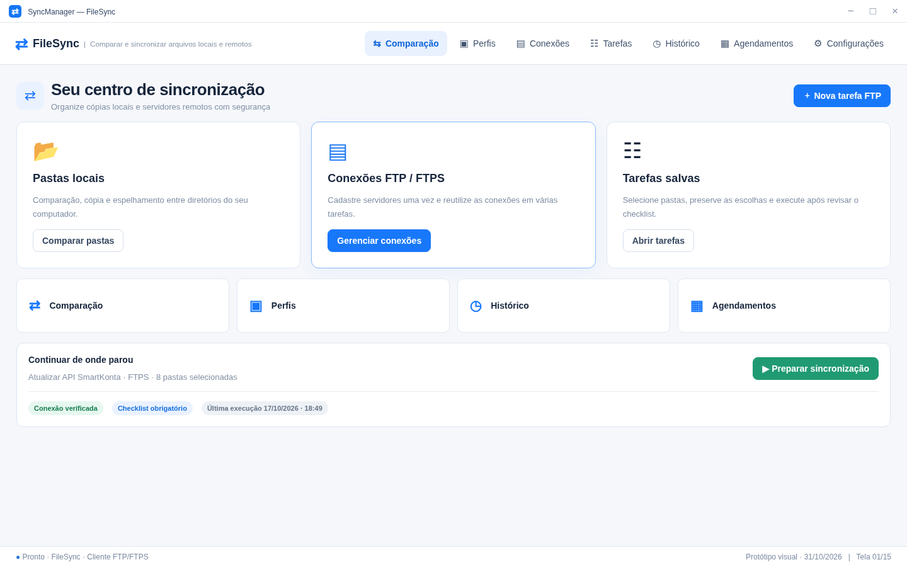

- **Header e Identidade:** Logotipo FileSync com barra de navegação global (*Comparação*, *Perfis*, *Conexões*, *Tarefas*, *Histórico*, *Agendamentos*, *Configurações*).
- **Cards de Métricas:**
  - `3 Conexões salvas`
  - `4 Tarefas ativas`
  - `2 Agendadas`
  - `12 min Última sync`
- **Banner de Proteção:** Alerta de ambiente de produção com exigência de checklist manual antes de qualquer envio.
- **Painel Duplo:**
  - *Esquerda:* Lista de conexões salvas (SmartKonta API FTPS, Backup Semanal FTP, Staging / Homologação SFTP).
  - *Direita:* Tarefas recentes com escopo salvo e ações de execução rápida e comparação.

---

### Telas 02, 03, 04, 05 e 06 — Conexões e Diagnóstico de Servidor

#### Tela 02: Gerenciamento de Conexões Salvas
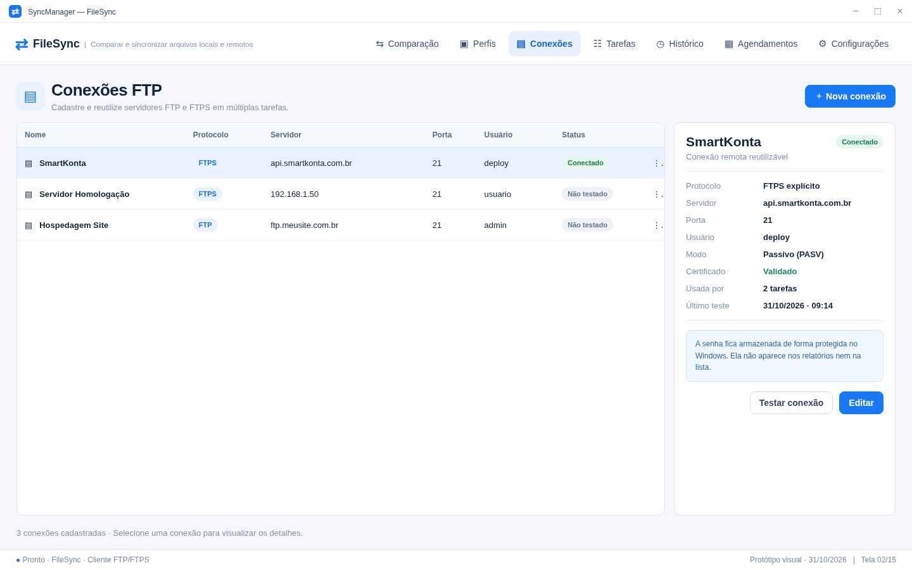
- Listagem de todas as conexões cadastradas com status de criptografia, tipo de protocolo, porta e host.
- Ações rápidas de Testar Conexão, Editar, Clonar e Excluir.

#### Tela 03: Nova Conexão — Configurações Gerais
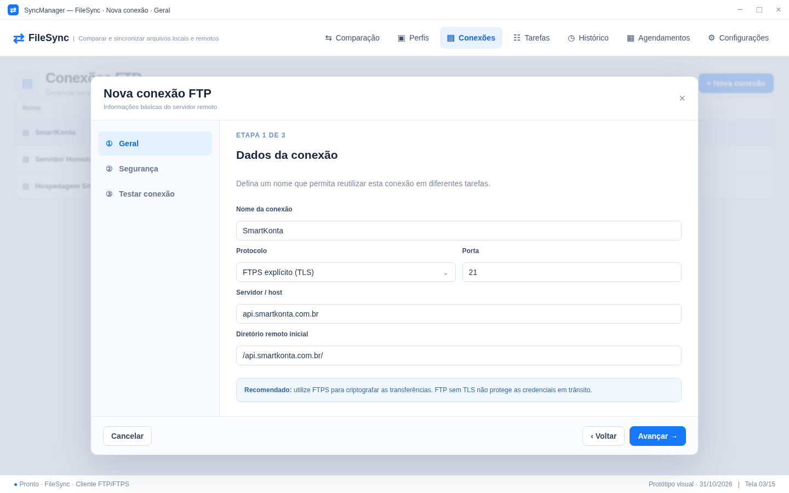
- **Campos Principais:**
  - `Nome da Conexão`: Identificador amigável (ex.: `SmartKonta API`).
  - `Servidor (Host)` e `Porta`: Endereço FQDN/IP e porta (padrão 21 para FTPS explícito, 990 para implícito).
  - `Protocolo`: Suporte a `FTPS (FTP com TLS explícito - Recomendado)`, `FTPS (Implícito)` e `FTP Padrão`.
  - `Usuário` e `Senha`: Campo mascarado com credenciais salvas via DPAPI.
  - `Modo de Transferência`: Passivo (`PASV` - recomendado para firewalls/NAT) ou Ativo (`PORT`).
  - `Codificação`: UTF-8 obrigatório para compatibilidade com nomes de arquivos complexos e acentuados.

#### Tela 04: Nova Conexão — Segurança e Certificados TLS
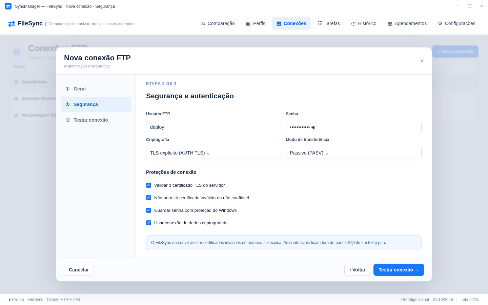
- **Nível de Criptografia:** Exigência mínima de TLS 1.2 com cifras seguras (GCM/AES).
- **Inspeção de Certificado:**
  - Emitido para: `*.smartkonta.com.br`
  - Autoridade Certificadora: Let's Encrypt Authority R3
  - Algoritmo: SHA-256 com chave RSA de 2048 bits
- **Travas:**
  - Certificate Pinning: Bloqueia a conexão caso a chave pública ou hash do certificado seja alterada sem autorização.
  - Bloqueio estrito de conexões sem criptografia.

#### Tela 05: Diagnóstico e Teste de Conexão
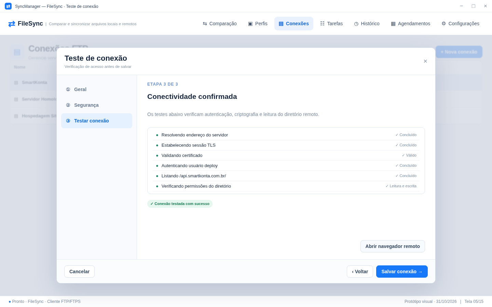

A tela de diagnóstico executa um teste completo e auditável composto por 8 etapas:
1. `Resolução DNS`: FQDN resolvido para IP com latência aferida.
2. `Conexão TCP`: Porta 21 aberta com handshake estabelecido.
3. `Negociação AUTH TLS`: Cifra e versão TLS confirmadas (TLSv1.3 AES-256).
4. `Verificação de Certificado`: Cadeia de confiança e validade validadas.
5. `Autenticação do Usuário`: Verificação de login e privilégios.
6. `Modo Passivo (PASV)`: Abertura do canal de dados de alta velocidade.
7. `Listagem de Diretório`: Execução de `MLSD` ou `LIST` com leitura de itens.
8. `Suporte a ModTime`: Teste do comando `MFMT` para carimbo de data/hora.

#### Tela 06: Navegador Remoto e Pastas Iniciais
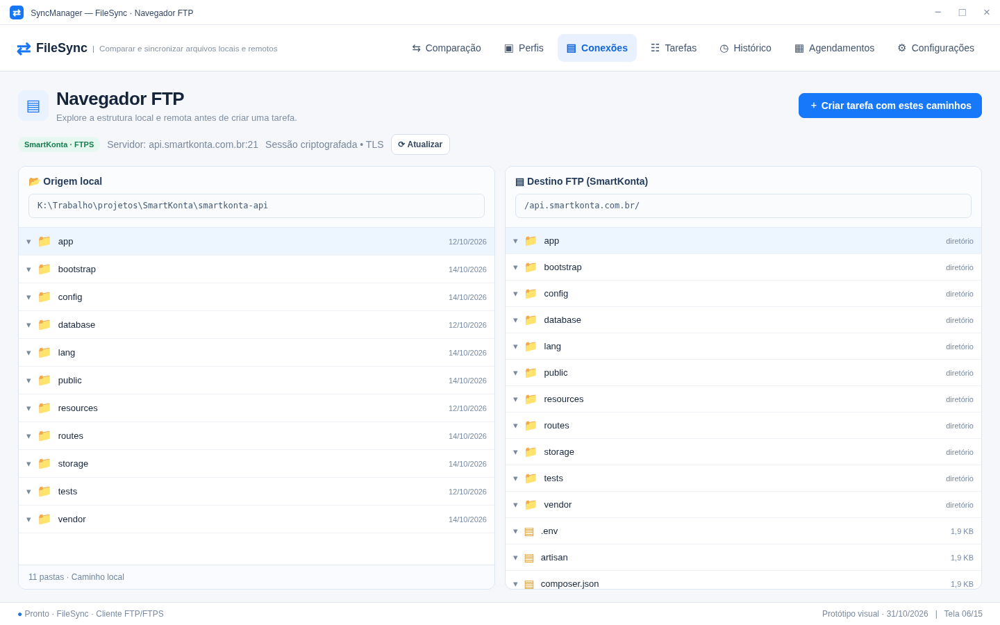
- **Pasta Local Padrão:** Caminho absoluto do repositório/projeto local.
- **Pasta Remota Inicial:** Caminho no servidor (ex.: `/api.smartkonta.com.br/public_html`).
- **Navegador em Árvore:** Exploração de diretórios remotos direto na interface para seleção precisa da raiz de sincronização.
- **Opções Avançadas e Performance:**
  - Conexões Paralelas (threads de transferência, padrão 4).
  - Timeouts de conexão e dados (30s).
  - Comando `MFMT` / `MDTM` habilitado para preservação de ModTime.
  - Pacotes de Keep-Alive `NOOP` periódicos.

---

### Telas 07 a 11 — Wizard de Criação e Configuração de Tarefa com Escopo Persistente

#### 07: Conexão e Metadados
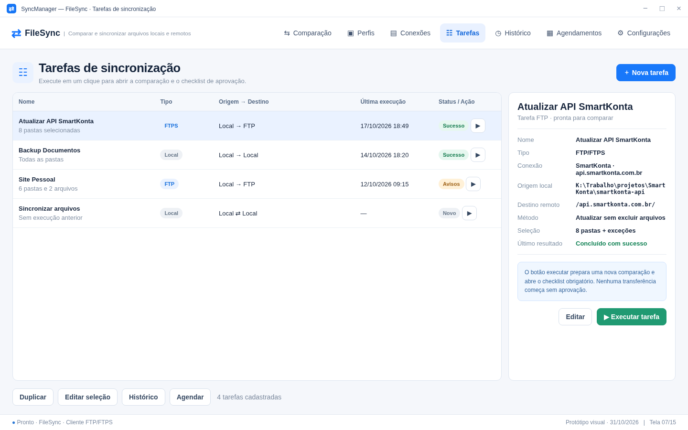
- Vinculação à conexão remota homologada e definição de nome descritivo da tarefa.

#### 08: Origem e Destino
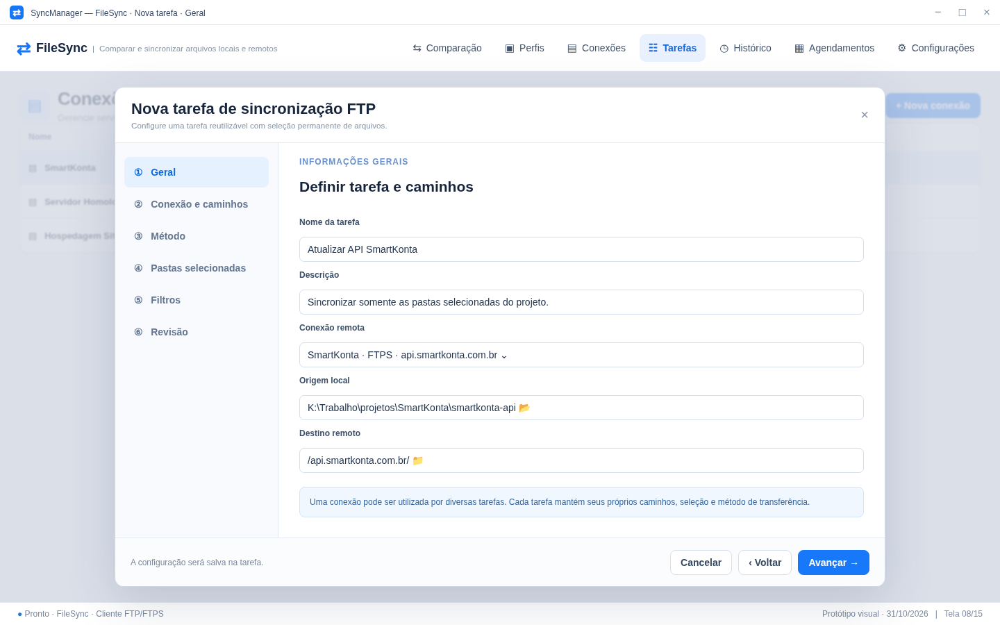
- Mapeamento explícito das pastas raiz local e remota.

#### 09: Método de Sincronização e Políticas de Exclusão
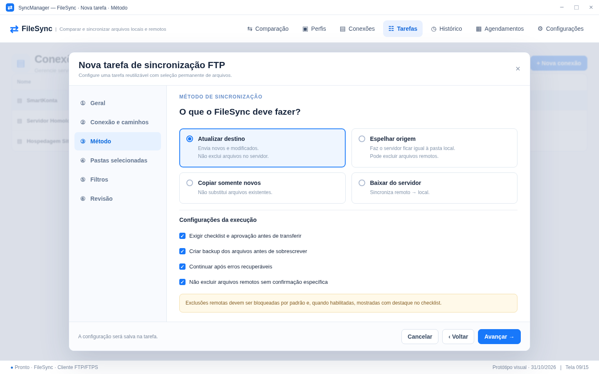
- **Modos de Sincronização:**
  - `Atualizar destino`: Envia arquivos novos e modificados sem apagar arquivos existentes no servidor remoto.
  - `Espelhar origem`: Mantém o servidor remoto idêntico à origem local (operações de exclusão remota são bloqueadas por padrão até aprovação no checklist).
  - `Copiar somente novos`: Não sobrescreve versões com o mesmo nome.
  - `Baixar do servidor`: Sentido reverso (Download/Backup).
- **Travas de Execução:**
  - [x] Exigir checklist e aprovação manual pré-execução.
  - [x] Criar backup remoto antes de sobrescrever.
  - [x] Não excluir arquivos remotos sem confirmação específica.

#### 10: Escopo Persistente de Pastas
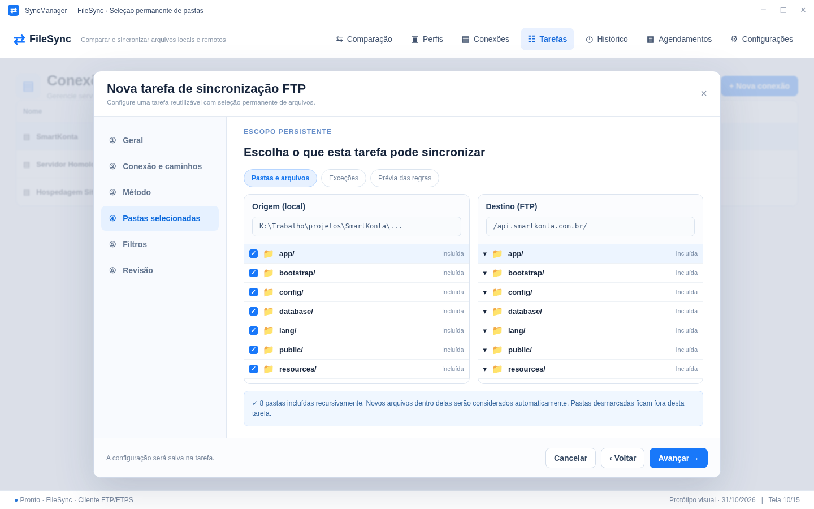
- Seleção granular em árvore: as pastas marcadas (ex.: `app/`, `config/`, `routes/`, `resources/`) ficam gravadas na tarefa.
- Pastas não selecionadas (ex.: `storage/`, `tests/`) são completamente ignoradas pelo motor de comparação e transferência.

#### 11: Filtros de Exclusão e Proteção de Arquivos Sensíveis
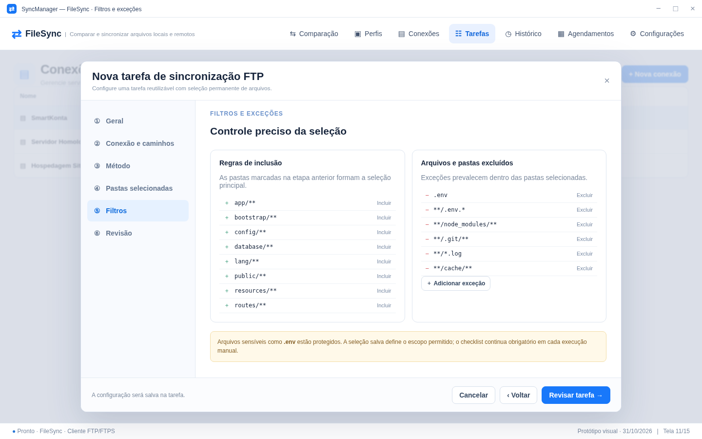
- Regras de exclusão automáticas ativas:
  - `.env` e variações (`.env.production`, `.env.local`)
  - `**/.git/**` (metadados de controle de versão)
  - `**/node_modules/**` e `**/vendor/**`
  - `**/*.log`, caches temporários e dumps de banco de dados.

---

### Telas 12 e 13 — Comparação e Checklist Obrigatório de Execução

#### 12: Grid de Comparação Dual
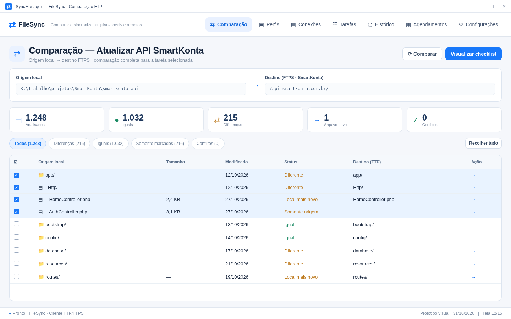
- Painel analítico com contadores:
  - `1.248 Analisados`
  - `1.032 Iguais` (Verde)
  - `215 Diferenças / Modificados` (Laranja)
  - `1 Novo` (Azul)
  - `0 Conflitos`
- Grid com status de cada arquivo, tamanho, data de modificação em ambos os lados e ação proposta (`→ Upload`, `⟳ Atualizar`, `— Manter`).
- Botão de destaque: `Visualizar checklist`.

#### 13: Checklist Obrigatório Pré-Execução
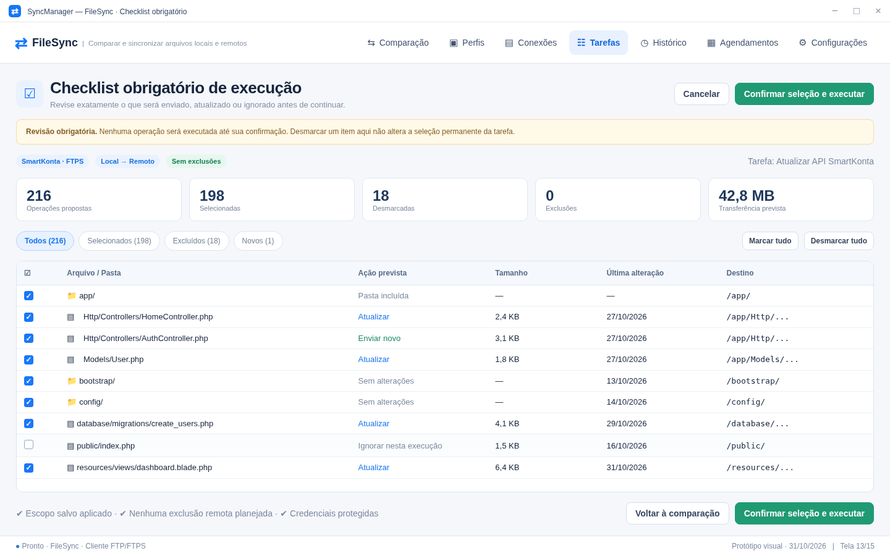
- **Trava de Segurança Final:** Nenhuma conexão de escrita é iniciada antes da aprovação nesta tela.
- **Resumo do Plano Proposto:**
  - `216 Operações Propostas`
  - `198 Selecionadas` (42,8 MB a transferir)
  - `18 Desmarcadas / Ignoradas`
  - `0 Exclusões`
- Permite desmarcar itens individuais pontualmente nesta execução sem alterar o escopo salvo da tarefa.
- Botão de confirmação de segurança com destaque verde: `Confirmar seleção e executar`.

---

### Telas 14 e 15 — Execução em Tempo Real e Histórico de Auditoria

#### 14: Execução e Monitoramento de Transferência
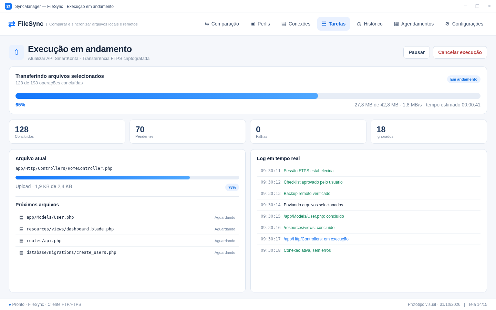
- **Métricas em Tempo Real:**
  - Barra de progresso geral percentual e por volume (27,8 MB de 42,8 MB - 65%).
  - Taxa de transferência (`1,8 MB/s`) e tempo estimado restante (`ETA: 00:00:41`).
  - Contadores: Concluídos, Pendentes, Falhas e Ignorados.
- **Painel Inferior:**
  - *Arquivo atual:* Sub-barra de progresso individual (`app/Http/Controllers/HomeController.php` - 78%).
  - *Próximos arquivos:* Fila de espera visível.
  - *Log de comandos:* Histórico das respostas do servidor FTP (`220`, `230`, `PASV`, `STOR`, `MFMT`).

#### 15: Histórico e Auditoria Forense
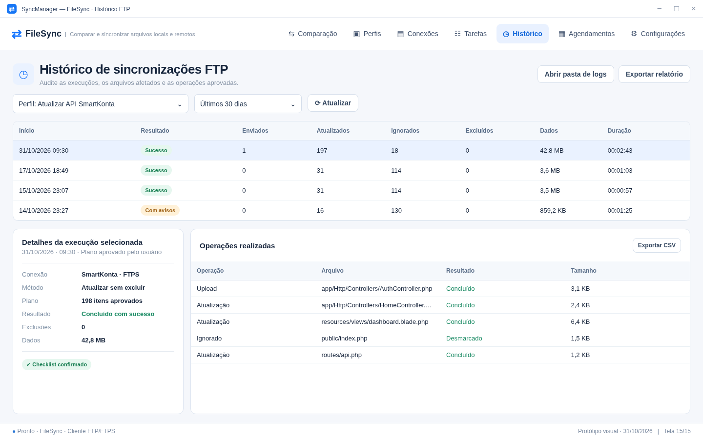
- Tabela com histórico completo de execuções anteriores, carimbo de data/hora, status (`Sucesso`, `Com avisos`, `Falha`), dados transferidos e duração.
- Detalhamento de cada arquivo afetado na execução selecionada.
- Recursos de exportação de relatórios em formato CSV e abertura da pasta de logs detalhados.

---

## 4. Modelagem de Dados e Contratos de Serviço (C# / .NET 10)

Para a implementação no Core e na Infrastructure do FileSync, foram estabelecidas as seguintes interfaces e modelos:

### 4.1 Entidades de Conexão e Segurança
```csharp
namespace SyncManager.Core.Domain.Ftp;

public enum FtpProtocol
{
    FtpPlain,
    FtpsExplicit, // TLS sobre a porta 21 (Recomendado)
    FtpsImplicit  // TLS direto na porta 990
}

public enum FtpTransferMode
{
    Passive, // PASV
    Active   // PORT
}

public class FtpConnectionProfile
{
    public Guid Id { get; set; } = Guid.NewGuid();
    public string Name { get; set; } = string.Empty;
    public string Host { get; set; } = string.Empty;
    public int Port { get; set; } = 21;
    public FtpProtocol Protocol { get; set; } = FtpProtocol.FtpsExplicit;
    public string Username { get; set; } = string.Empty;
    
    // Credencial protegida via Windows Credential Manager / DPAPI
    public string CredentialIdentifier { get; set; } = string.Empty;
    
    public FtpTransferMode TransferMode { get; set; } = FtpTransferMode.Passive;
    public bool RequireTls13Or12 { get; set; } = true;
    public bool CertificatePinning { get; set; } = false;
    public string? ExpectedCertificateThumbprint { get; set; }
    
    public string DefaultLocalPath { get; set; } = string.Empty;
    public string DefaultRemotePath { get; set; } = "/";
    public bool TreatRemoteAsRoot { get; set; } = true;
    
    public int MaxParallelConnections { get; set; } = 4;
    public int TimeoutSeconds { get; set; } = 30;
    public bool PreserveModTime { get; set; } = true; // MFMT / MDTM
    public bool SendKeepAlive { get; set; } = true;    // NOOP
}
```

### 4.2 Definição de Tarefa com Escopo Persistente
```csharp
namespace SyncManager.Core.Domain.Tasks;

public enum SyncDirectionMethod
{
    UpdateTarget,   // Envia novos e modificados, sem exclusão remota
    MirrorSource,   // Espelha origem, permitindo exclusão sob checklist
    CopyNewOnly,    // Apenas arquivos não existentes
    DownloadServer  // Remoto para local
}

public class FtpSyncTask
{
    public Guid Id { get; set; } = Guid.NewGuid();
    public string Name { get; set; } = string.Empty;
    public string Description { get; set; } = string.Empty;
    public Guid ConnectionProfileId { get; set; }
    
    public string SourceLocalPath { get; set; } = string.Empty;
    public string TargetRemotePath { get; set; } = string.Empty;
    public SyncDirectionMethod Method { get; set; } = SyncDirectionMethod.UpdateTarget;
    
    // Escopo persistente: caminhos relativos selecionados permanentemente
    public HashSet<string> IncludedRelativePaths { get; set; } = new(StringComparer.OrdinalIgnoreCase);
    
    // Filtros e padrões de exclusão
    public List<string> ExclusionPatterns { get; set; } = new()
    {
        ".env*",
        "**/.git/**",
        "**/node_modules/**",
        "**/vendor/**",
        "**/*.log"
    };
    
    // Travas de segurança
    public bool RequireChecklistApproval { get; set; } = true;
    public bool BackupBeforeOverwrite { get; set; } = true;
    public bool ProhibitRemoteDeletions { get; set; } = true;
}
```

### 4.3 Checklist e Execução
```csharp
namespace SyncManager.Core.Domain.Operations;

public enum FtpPlannedAction
{
    Keep,
    UploadNew,
    UpdateExisting,
    DeleteRemote,
    IgnoreManual
}

public class FtpChecklistItem
{
    public string RelativePath { get; set; } = string.Empty;
    public string RemoteDestinationPath { get; set; } = string.Empty;
    public FtpPlannedAction ProposedAction { get; set; }
    public bool IsSelectedForExecution { get; set; }
    public long FileSizeBytes { get; set; }
    public DateTime LocalModifiedTime { get; set; }
    public DateTime? RemoteModifiedTime { get; set; }
}
```

---

## 5. Matriz de Requisitos e Critérios de Aceite

| Requisito | Critério de Aceite | Validação |
| :--- | :--- | :--- |
| **Criptografia TLS 1.3/1.2** | Conexões FTPS recusam cifras fracas ou rebaixamento para texto plano | Teste de conexão (Tela 06) |
| **Proteção de Credenciais** | Nenhuma senha armazenada em plain text no banco ou XML de configuração | DPAPI / CredentialStore |
| **Isolamento de Escopo** | Arquivos fora das pastas marcadas no escopo nunca aparecem para envio | Validação de comparação (Tela 12) |
| **Proteção de Arquivos Sensíveis** | `.env`, `.git` e credenciais são bloqueados por padrão nas regras de filtro | Motor de filtros (Tela 11) |
| **Checklist Obrigatório** | Nenhuma transferência ocorre sem o clique de confirmação do checklist | Trava da Tarefa (Tela 13) |
| **Preservação de Data** | Arquivos gravados no servidor mantêm timestamp de modificação idêntico ao local | Comando MFMT (RFC 3659) |
| **Auditoria e Logs** | Todas as ações geram histórico discriminado exportável para análise forense | Histórico e CSV (Tela 15) |

---

*Documento gerado como especificação oficial do Módulo FTP/FTPS do FileSync.*
